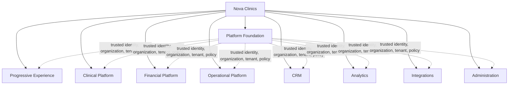
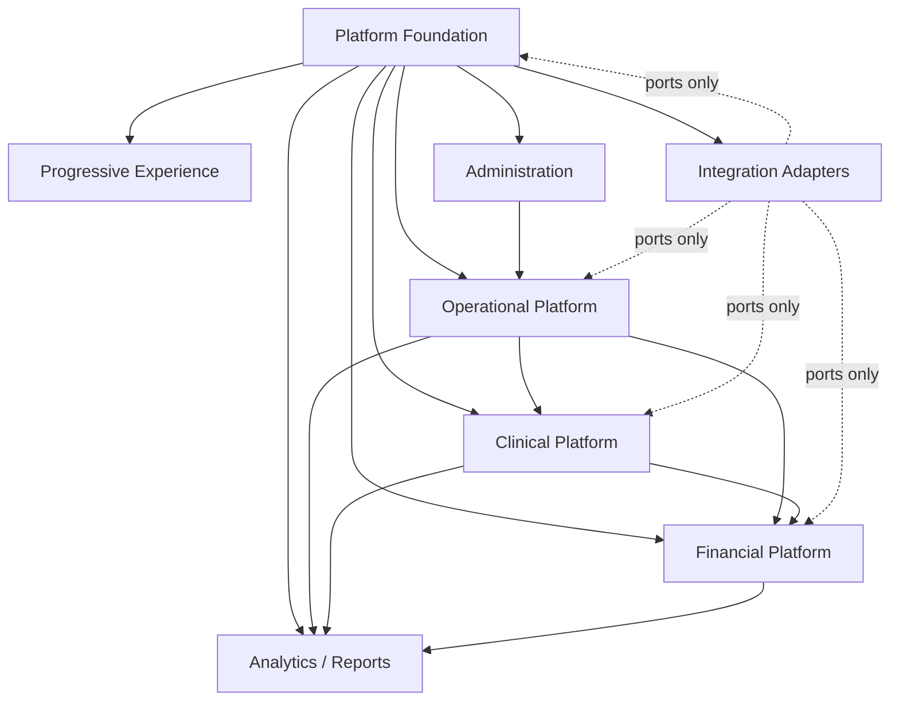
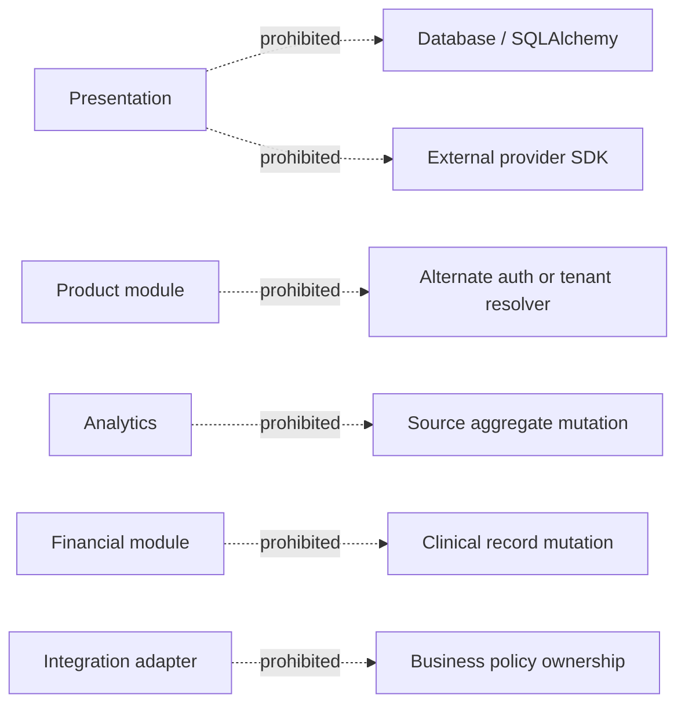
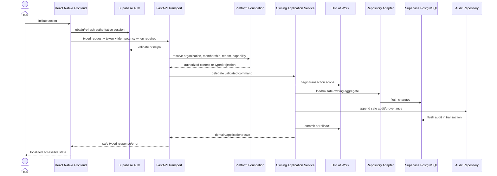
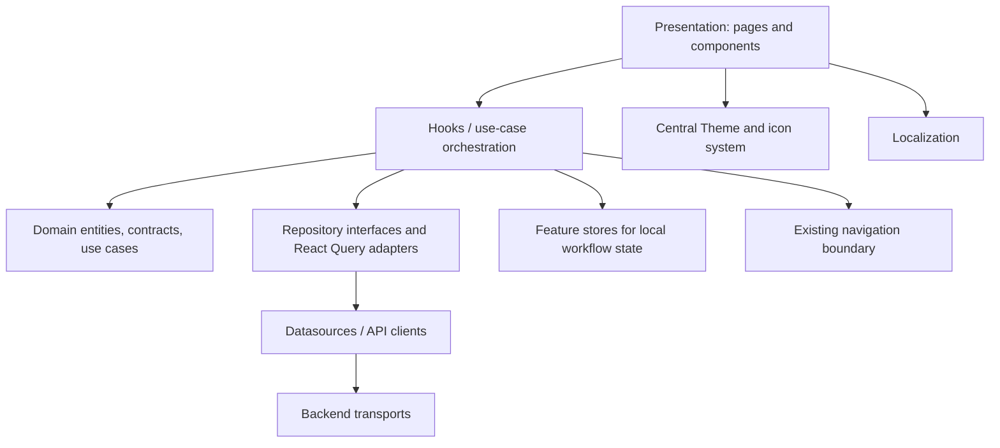
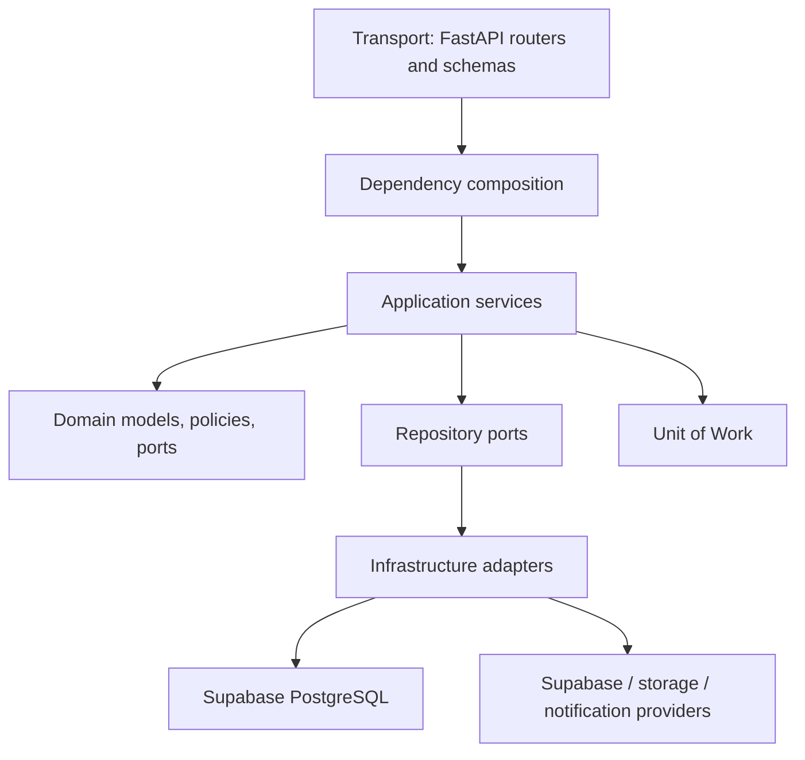
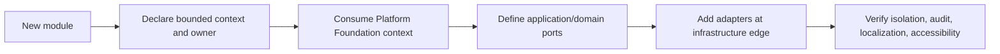
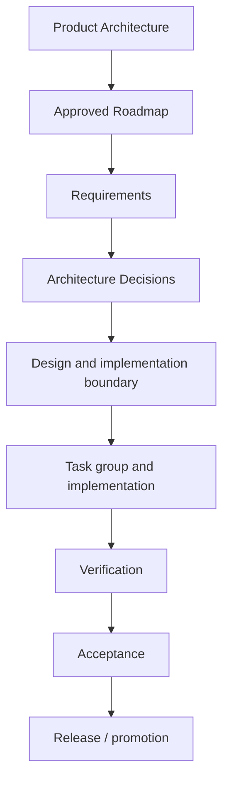

# Nova Clinics Product Architecture

Status: **Authoritative product architecture handbook**

Baseline: **TG19 / Epic 2 Version 1 accepted**

Audience: Solution architects, principal engineers, technical leads, senior developers, reviewers, and AI coding agents

> Start here. This document defines the product-wide module map, dependency
> direction, ownership, extension boundaries, and governance model. The
> Platform Foundation guide and ADRs provide deeper authoritative decisions.
> This handbook does not turn future roadmap areas into implemented behavior.

## 1. Product vision

Nova Clinics is a multi-clinic healthcare operating platform that connects
organization administration, clinic operations, longitudinal clinical work,
financial workflows, and progressive product adoption without collapsing their
ownership boundaries.

The product follows three complementary principles:

- **Organization first:** organizations own membership and clinic associations;
  every workspace action occurs in an authorized organization and effective
  clinic context.
- **Platform first:** identity, authorization, tenancy, capability, audit,
  verification, idempotency, and transaction rules are solved once and consumed
  by every module.
- **Clinical first:** patient safety, longitudinal clinical meaning, provenance,
  and workflow continuity take priority inside clinical contexts. Administrative
  convenience must not corrupt clinical authority.

The architecture supports incremental adoption: Progressive Experience helps an
organization enter and prepare its workspace, while module boundaries let Nova
Clinics expand without constructing parallel identity, tenant, repository, or
audit systems.

> **Product decision:** Platform Foundation establishes trusted context. Product
> modules own business behavior. Neither may absorb the other.

## 2. Product layer architecture

| Layer | Architectural purpose | Current interpretation |
|---|---|---|
| Platform Foundation | Trusted identity, organization, clinic tenancy, authorization, capabilities, verification, audit, idempotency, and transactions. | Implemented and accepted through TG19. |
| Progressive Experience | Guides clinic entry, workspace preparation, readiness, and progressive adoption. | Implemented foundation and accepted Clinic Entry; later roadmap epics remain separately governed. |
| Clinical Platform | Owns patient-facing clinical records and longitudinal care workflows. | Multiple implemented modules exist; the broader future Clinical Workspace remains separately governed. |
| Financial Platform | Owns charge, invoice, payment, and financial-state concepts. | Billing surfaces exist; future financial expansion and payment-gateway work are not implied. |
| Operational Platform | Owns scheduling, resources, staff operations, inventory, and day-to-day clinic execution. | Several modules exist with independent maturity; future expansion requires its own requirements and acceptance. |
| CRM | Owns prospect/referral/relationship workflows outside the clinical patient record. | Future product area; no complete CRM architecture is asserted here. |
| Analytics | Produces authorized derived insights and reports from source-owned data. | Analytics/reporting modules exist; a generalized analytics platform remains future work. |
| Integrations | Adapts approved external systems at explicit ports. | Existing storage, Supabase, notification, and selected provider integrations exist; a general integration marketplace does not. |
| Administration | Provides governed configuration for platform, organization, clinic, RBAC, capabilities, templates, localization, and branding. | Implemented across bounded administrative modules. |

## 3. Platform Foundation

Platform Foundation is described authoritatively in
`NOVA-PLATFORM-FOUNDATION-ARCHITECTURE.md`. Product modules must consume that
guide rather than duplicate it.

It owns:

- Supabase-backed authoritative identity abstraction;
- organizations, memberships, clinic associations, and effective tenant;
- organization roles and platform capabilities;
- contact and ownership verification strategy composition;
- scoped idempotency, immutable audit/provenance, and transaction rules;
- safe transport errors and isolation invariants.

It never owns patient care, consultation content, appointments, episodes, case
sheets, prescriptions, treatment planning or delivery, invoices, payments,
inventory, CRM journeys, or module-specific UX.

> **Boundary note:** A module may request an authenticated principal,
> organization context, effective tenant, or authorization decision. It may not
> infer or persist an alternate version of any of them.

## 4. Product module map

Status labels distinguish repository evidence from roadmap organization:

- **Implemented:** a concrete module boundary exists in the current repositories.
- **Implemented foundation:** a bounded implementation exists, but this document
  does not claim every future journey is complete.
- **Future product area:** logical ownership is recorded without asserting an
  implementation.

### 4.1 Platform and administration modules

| Module | Status | Purpose and owner | Dependencies | Consumers |
|---|---|---|---|---|
| Authentication | Implemented | Supabase authentication adapter and application identity boundary; Platform Foundation owns policy. | Supabase Authentication, configuration. | Every authenticated module. |
| Organization | Implemented | Organization root, membership, owner/admin lifecycle, and organization audit; Platform Foundation. | Authentication, transactions, repositories. | Clinic Entry, administration, every organization-scoped module. |
| Clinics / Tenants | Implemented | Clinic profile, organization association, identity/contact persistence, and effective-tenant context; Platform Foundation plus clinic administration. | Organization, verification, Supabase session metadata. | Workspace and all tenant-scoped modules. |
| Staff and RBAC | Implemented | Staff records, invitations/access, tenant roles, permissions, and working context; Administration/Operations. | Organization/tenant context, auth, capabilities where applicable. | Scheduling, clinical modules, billing, administration. |
| Platform Capabilities | Implemented | Platform-wide sensitive-operation authorization and audited assignment/bootstrap; Platform Foundation. | Authenticated platform actor, platform audit. | Manual verification and future platform administration. |
| Global/Clinic Settings | Implemented foundation | Govern platform, organization, and clinic configuration at the correct scope. | Platform Foundation, localization, feature flags. | Product modules reading approved configuration. |
| Templates | Implemented | Reusable organization/clinic configuration templates and clinical templates where bounded. | Tenant context, authorization. | Case sheets, configuration workflows, onboarding. |
| Tenant Branding | Implemented | Tenant-owned presentation branding configuration. | Effective tenant, theme boundary. | Frontend shell and authorized branded surfaces. |
| Localization | Implemented | Locale catalogs and localized configuration/labels. | Configuration and frontend localization infrastructure. | Every user-visible module. |

### 4.2 Progressive Experience and operational modules

| Module | Status | Purpose and owner | Dependencies | Consumers |
|---|---|---|---|---|
| Progressive Experience | Implemented foundation | Clinic Entry, readiness journey, wizard progression, draft recovery, and workspace preparation; Product Experience. | Platform Foundation, onboarding repository, theme, localization, navigation. | New and returning organization/clinic users. |
| Appointments | Implemented | Appointment lifecycle and schedule-facing booking state; Operational Platform. | Patient, clinic, staff/resource availability, authorization. | Consultation, episodes, billing, notifications, dashboards. |
| Appointment Rules | Implemented | Clinic scheduling constraints and rule configuration. | Clinic settings, operating hours, rooms, staff availability. | Appointment creation and validation. |
| Operating Hours | Implemented | Clinic availability windows. | Effective tenant, clinic administration. | Scheduling and appointment rules. |
| Rooms | Implemented | Clinic resource/location configuration. | Effective tenant, clinic administration. | Appointment and treatment-session allocation. |
| Staff Operations | Implemented foundation | Staff lists, dashboards, availability, and role-specific work surfaces. | Staff/RBAC, effective tenant, appointments. | Operational and clinical workspaces. |
| Inventory | Implemented foundation | Stock, batches, and treatment-material usage ownership. | Effective tenant, authorization, clinical/financial references where approved. | Treatment delivery, operations, financial reconciliation. |
| Notifications | Implemented foundation | Notification delivery and user preferences. | Identity/contact channels, events, tenant/user preferences. | Appointments and approved product workflows. |
| Documents / Bulk Upload | Implemented foundation | File/document ingestion and storage-adapter workflows. | Authorization, storage ports, tenant context, validation. | Administrative and approved clinical workflows. |

### 4.3 Clinical modules

| Module | Status | Purpose and owner | Dependencies | Consumers |
|---|---|---|---|---|
| Patients / Clients | Implemented | Authoritative tenant-scoped patient identity and demographic record; Clinical Platform. | Effective tenant, authorization, validation. | Appointments, episodes, case sheets, prescriptions, treatment, billing. |
| Consultation | Implemented foundation | Clinician encounter workflow and consultation-facing workspace behavior. | Patient, appointment, staff/RBAC, clinical services. | Episodes, case sheets, prescriptions, treatment planning. |
| Episodes | Implemented | Longitudinal episode-of-care boundary and lifecycle. | Patient, appointment/clinical context, authorization. | Case sheets, treatment plans, clinical timelines, reports. |
| Case Sheets | Implemented | Structured clinical documentation and templates with clinical provenance. | Patient, episode, staff identity, templates. | Clinical review, treatment decisions, reports. |
| Prescriptions | Implemented | Medication/prescription record and related clinical actions. | Patient, encounter/episode context, prescriber authorization. | Patient care, clinical review, documents. |
| Clinical Services | Implemented | Catalog of clinical services and their operational/financial references. | Tenant configuration and capabilities. | Appointments, treatment, billing. |
| Treatment Plans | Implemented foundation | Planned course of treatment and approved clinical progression. | Patient, episode, clinical services, authorized clinician. | Treatment sheets/sessions, clinical review, billing references. |
| Treatment Sheets | Implemented | Longitudinal execution/recording structure for treatment delivery. | Treatment plan, patient, staff, clinical semantics. | Treatment sessions, dashboards, reports. |
| Treatment Sessions | Implemented | Session-level treatment delivery workflow and status. | Treatment plan/sheet, appointment, staff, inventory where approved. | Clinical timeline, billing references, reports. |
| Clinical Dashboards | Implemented foundation | Role-specific doctor/therapist clinical views and timelines. | Clinical source modules, effective tenant, RBAC. | Doctors, therapists, reviewers. |

### 4.4 Financial, relationship, insight, and integration modules

| Module | Status | Purpose and owner | Dependencies | Consumers |
|---|---|---|---|---|
| Billing / Invoices | Implemented foundation | Tenant financial documents and charge/invoice state; Financial Platform. | Patient, clinical service/treatment references, authorization. | Clinic administration, reports, future payments. |
| Payments | Future product area | Payment collection, settlement, refund, and gateway orchestration. | Billing plus approved provider ports and audit. | Financial operations and reporting. |
| CRM | Future product area | Prospects, referrals, campaigns, and non-clinical relationships. | Platform Foundation; explicit patient-conversion contract if approved. | Growth and relationship teams. |
| Feedback | Implemented foundation | User/patient feedback capture within approved context. | Tenant context, safe identity/contact handling. | Administration and analytics. |
| Reports | Implemented foundation | Authorized operational/clinical/financial read models and exports. | Source module contracts, effective tenant, authorization. | Owners, administrators, clinicians. |
| Analytics | Implemented foundation | Derived metrics and dashboards without taking source-data ownership. | Source module read contracts, authorization, tenant isolation. | Dashboards, reports, product decision support. |
| AI Assistance | Future product area | Assistive, reviewable intelligence over explicitly authorized product data. | Source-owned contracts, privacy/security governance, audit. | Future clinical and administrative workflows. |
| External Integrations | Implemented adapters plus future area | Supabase, storage, notifications, and approved provider adapters; future integrations enter through ports. | Platform configuration, secrets boundary, authorization. | Modules requiring external services. |

## 5. Module dependency graph

The graph describes allowed conceptual dependencies, not permission for arbitrary
database access. Each dependency must use an owned application contract, domain
port, event, or read model.

### Prohibited dependencies

Other modules may reference clinical or operational identifiers, but they do
not take ownership of the source aggregate. Analytics reads; it does not become
the source. Financial workflows reference clinical services; they do not edit
clinical truth.

## 6. Bounded contexts

| Bounded context | Owns | Contract boundary |
|---|---|---|
| Identity and Access | Authenticated identity adapter, membership authorization, tenant RBAC, platform capabilities. | Principal/context/decision interfaces; no module-owned auth copies. |
| Organization and Tenancy | Organization, membership, clinic association, effective tenant. | Platform Foundation application services and repository ports. |
| Verification and Trust | Contact/ownership evidence, strategies, decisions, provenance. | Typed lifecycle operations and opaque evidence references. |
| Progressive Experience | Journey projection, Clinic Entry orchestration, wizard readiness and recovery. | Onboarding repository/datasource and Platform Foundation APIs. |
| Patient Registry | Patient/client identity and demographics within tenant. | Patient application API/repository; identifiers referenced elsewhere. |
| Scheduling and Resources | Appointments, rules, operating hours, rooms, availability. | Scheduling application services and events/read models. |
| Clinical Record | Episodes, case sheets, prescriptions, clinical semantics and provenance. | Clinical commands/queries; protected source aggregates. |
| Treatment Delivery | Treatment plans, sheets, sessions, lifecycle actions. | Treatment application services and explicit clinical references. |
| Financials | Invoices, line items, financial status; future payment boundary. | Financial commands/queries; references but does not own patient/clinical entities. |
| Inventory | Items, batches, stock movement, material usage. | Inventory commands/queries and explicit treatment-usage contract. |
| Communications | Notifications, preferences, feedback channels. | Event/notification ports and user preferences. |
| Insight | Analytics, KPI, and reports. | Authorized read models; no source writes. |
| Administration | Settings, templates, branding, localization configuration. | Scope-aware configuration services. |
| Integrations | External provider adapters and storage/communication clients. | Domain/application ports; adapters own protocol, not policy. |

The shared kernel is intentionally small: stable identifiers, tenant context,
time/value primitives, safe typed errors, pagination/transport conventions, and
cross-cutting interfaces. Patient, appointment, episode, invoice, inventory, or
verification models do not enter the shared kernel merely because multiple
modules reference them.

> **DDD rule:** Referencing another context's identifier does not transfer
> aggregate ownership. Cross-context mutation goes through the owning context.

## 7. End-to-end request lifecycle

1. Presentation captures intent; it does not decide authority.
2. Supabase proves authentication.
3. Platform Foundation resolves organization, membership, effective tenant, and
   capability context.
4. Transport validates and delegates.
5. The owning application service enforces business policy.
6. Repository adapters load/flush through ports.
7. Supabase PostgreSQL is authoritative.
8. Mandatory audit/provenance participates in the same transaction.
9. Safe typed outcomes return to localized, accessible UI.

## 8. Cross-cutting concerns

| Concern | Architectural owner | Product-wide rule |
|---|---|---|
| Authentication | Platform Foundation / Supabase adapter | Supabase is authoritative; no alternate auth system. |
| Authorization | Platform Foundation plus owning module policy | Membership/tenant/capability is server-resolved; modules add domain authorization. |
| Effective tenant | Platform Foundation | Must be committed and refreshed before workspace/module access. |
| Audit | Platform Foundation infrastructure and owning application service | Organization vs platform scope is explicit; records are append-only. |
| Logging | Backend core infrastructure | Structured operational diagnostics; never substitute for audit or expose secrets. |
| Idempotency | Platform Foundation service plus operation owner | Scope and request fingerprint are mandatory for protected retries. |
| Configuration | Core settings and scoped administration | Typed, environment-validated, fail closed for security decisions. |
| Localization | Frontend localization plus configuration-owned labels | User-visible text uses catalogs; `en-US` and `hi-IN` parity for introduced strings. |
| Accessibility | Frontend presentation | Accessible roles, names, focus, live states, target sizes, and navigation are acceptance concerns. |
| Feature flags | Core/platform configuration | Flags gate approved behavior; they do not replace authorization or architecture. |
| Validation | Transport, domain, and database at distinct layers | Shape at transport, invariant in domain/application, concurrency/uniqueness in database. |
| Transactions | Application service and UoW | Repository flushes; caller commits/rolls back mutation and required audit atomically. |
| Error handling | Domain/application typed failures and transport mapping | Stable safe categories; no raw backend/provider/database text reaches UI. |

## 9. Frontend architecture

- **Presentation** renders domain/view state and accessible interaction; it does
  not perform direct networking or own persistence policy.
- **Domain** holds frontend entities, repository contracts, pure projections,
  and use cases without React Native or transport authority.
- **Data** maps API DTOs through datasources and repository implementations.
- **React Query** owns server-state caching, invalidation, cancellation, and
  mutation lifecycle. It is not a general local form store.
- **Stores** own bounded local/draft state with identity-aware cleanup. They do
  not duplicate server authority.
- **Navigation** occurs through existing routes and only after required
  authoritative context checks.
- **Theme/localization/accessibility** are mandatory architecture constraints,
  not post-implementation polish.

Feature folders should preserve this dependency direction. Cross-feature reuse
belongs in stable core abstractions or explicit contracts, not deep imports into
another feature's presentation internals.

## 10. Backend architecture

- Transport authenticates, validates shape, delegates, and maps typed errors.
- Dependency injection composes configured services and strategies; routers do
  not construct business graphs or branch on runtime policy.
- Application services orchestrate use cases, authorization, idempotency,
  repositories, audit, and transaction completion.
- Domain code owns business concepts, invariants, repository/service protocols,
  and typed failures.
- Infrastructure implements persistence, provider, event, cache, storage, and
  notification ports.
- Supabase remains authoritative for authentication, PostgreSQL, and approved
  session metadata.

## 11. Data ownership

| Entity / data family | Authoritative owner | Other-module access rule |
|---|---|---|
| Organization | Organization and Tenancy / Platform Foundation | Consume organization context/services; never duplicate. |
| Organization membership | Identity and Access / Platform Foundation | Server-resolved authorization only. |
| Clinic / tenant | Organization and Tenancy plus clinic administration | Reference effective tenant; changes use owning service. |
| Effective tenant | Platform Foundation | Read refreshed authoritative context; never infer client-side. |
| Verification evidence/provenance | Verification and Trust | Opaque references/status; no raw evidence leakage. |
| Platform capability | Platform Foundation | Consume capability decision; tenant RBAC is not a substitute. |
| Patient/client | Patient Registry | Clinical/operational/financial modules reference patient ID through contracts. |
| Appointment | Scheduling and Resources | Clinical and financial contexts consume explicit status/reference contracts. |
| Episode | Clinical Record | Treatment/reporting contexts reference; mutations stay clinical. |
| Case sheet | Clinical Record | Read through authorized clinical services; provenance is protected. |
| Prescription | Clinical Record | Patient/episode-scoped clinical ownership. |
| Treatment plan/sheet/session | Treatment Delivery | Other contexts use explicit references/events/read models. |
| Invoice | Financials | Clinical modules cannot mutate financial state directly. |
| Payment | Future Payments context | When approved, references invoices through financial contracts. |
| Inventory item/batch/movement | Inventory | Treatment usage uses the approved inventory boundary. |
| Organization audit | Platform Foundation | Append through organization audit port; no update/delete. |
| Platform audit | Platform Foundation | Platform-wide safe events only; no organization ID requirement. |
| Analytics/report output | Insight | Derived data; source modules remain authoritative. |

## 12. Extension strategy

Nova Clinics uses explicit extension ports rather than an unconstrained runtime
plugin marketplace.

To add a module:

1. Define its business purpose, aggregate ownership, personas, requirements, and
   explicit non-goals.
2. Map inbound/outbound dependencies and prohibit direct source-table ownership.
3. Reuse Platform Foundation identity, organization, tenant, capability, audit,
   idempotency, and transaction services.
4. Create ports only for a real boundary; extend existing repositories/services
   where ownership already exists.
5. Keep provider SDKs and protocols in infrastructure adapters.
6. Add focused contract, isolation, security, localization, accessibility, and
   integration evidence before acceptance.

Extensions are additive. A module cannot redefine a Platform Foundation
invariant. An architectural conflict returns to roadmap/requirements/ADR review
before code.

## 13. Architectural governance

| Artifact | Authority and owner |
|---|---|
| Product Architecture | Product Architecture owns the system-wide module map, dependency direction, and governance invariants. |
| Platform Foundation guide | Platform Architecture owns cross-product identity, organization, tenant, security, and runtime foundation contracts. |
| Roadmap | Product Architecture/Product owns approved product scope and sequence. |
| Requirements | Product owns observable behavior and acceptance criteria. |
| ADR | Architecture owns a durable decision, alternatives, consequences, and extension points. |
| Design | Solution Architecture owns concrete component/data/interaction boundaries consistent with requirements and ADRs. |
| Implementation readiness | Engineering and Architecture prove reuse, dependencies, decisions, files, and tests are sufficiently bounded. |
| Acceptance | Product, Architecture, Security, and Engineering verify delivered behavior and evidence. |
| Release | Release ownership validates environment, migration, operational, and promotion gates. |

> **Governance rule:** Product Architecture does not silently override an ADR;
> a task group does not redefine requirements; implementation does not create
> product scope. Conflicts stop and move upstream.

## 14. Canonical AI agent rules

AI coding agents working in Nova Clinics must obey all of the following:

1. Read this handbook, the Platform Foundation guide, applicable roadmap,
   requirements, design, ADRs, readiness boundary, and repository instructions
   before modifying code.
2. Never bypass Platform Foundation for authentication, organization,
   membership, capability, verification, or effective-tenant decisions.
3. Never create an alternate identity provider, organization model, tenant
   store, session authority, audit system, or tenant resolver without an
   approved architecture decision.
4. Never accept client-declared membership, role, capability, ownership,
   verification, or tenant authority.
5. Reuse existing components, hooks, stores, services, repositories, APIs,
   navigation, Theme, localization, and infrastructure before creating anything.
6. Never duplicate a repository or service because its interface is inconvenient;
   audit ownership and extend the existing boundary when appropriate.
7. Preserve Clean Architecture dependency direction. Presentation does not call
   the network directly; domain does not depend on frameworks; repositories do
   not own commit.
8. Preserve bounded-context ownership. Reference foreign identifiers through
   contracts; do not mutate another context's aggregate or table directly.
9. Preserve Supabase as authoritative authentication and PostgreSQL runtime.
10. Preserve organization and tenant isolation in queries, commands, caches,
    events, audit, retries, and tests.
11. Preserve idempotency, typed errors, immutable audit/provenance, and
    application-owned transaction boundaries.
12. Never log or expose credentials, tokens, raw verification evidence, contact
    values, fingerprints, raw provider responses, or internal exception text.
13. Use central Theme tokens only and localization-first `en-US`/`hi-IN` strings;
    preserve accessible semantics and multi-clinic/specialty neutrality.
14. Treat feature flags as behavior gates, never authorization substitutes.
15. Inspect the actual repository before proposing new architecture. Planning
    summaries are evidence pointers, not substitutes for source review.
16. Do not modify historical migrations, unrelated modules, or other worktrees.
17. Do not broaden a task because a useful adjacent improvement is visible.
18. If a required dependency or decision is undocumented, stop and record the
    blocker; do not invent architecture.
19. Run focused tests and applicable static/migration checks proportional to
    risk, then classify unrelated baseline debt explicitly.
20. Stage only reviewed files, preserve user changes, and report exact commit,
    push, and synchronization status.

> **AI warning:** A locally coherent implementation is still invalid if it
> violates product ownership, an ADR, tenant isolation, or the authorized task
> boundary.

## 15. Development workflow

| Stage | Required outcome | Primary responsibility |
|---|---|---|
| Requirements | Observable behavior, personas, acceptance, metrics, and non-goals. | Product with Architecture review. |
| Architecture | Context ownership, dependencies, invariants, and reuse direction. | Product/Solution Architecture. |
| ADR | Durable decisions for meaningful alternatives or cross-product authority. | Platform/Solution Architecture. |
| Design | Concrete domain, interaction, persistence, transport, and extension contracts. | Solution Architecture and senior engineering. |
| Implementation readiness | Exact reuse audit, open decisions closed, files/tests bounded. | Engineering lead and Architecture. |
| Implementation | Small authorized checkpoints following approved contracts. | Engineering. |
| Verification | Unit, contract, integration, security, isolation, migration, frontend, and non-functional evidence. | Engineering, QA, Security. |
| Acceptance | Requirement matrix and journeys classified with no owned blocker. | Product, Architecture, Engineering, QA. |
| Release | Staging/runtime configuration, migration, observability, rollback, and promotion gates. | Release/Operations with owners. |

The direction is forward. Discovery can send work back upstream, but an
implementation artifact never retroactively becomes an unreviewed requirement
or architecture decision.

## 16. Module roadmap

The following are logical future product areas, not implementation commitments:

| Area | Evolution intent | Non-negotiable foundation |
|---|---|---|
| Clinical Workspace | Unify safe role-specific clinical work around existing patient, episode, case-sheet, prescription, and treatment ownership. | Consume Platform Foundation and preserve clinical aggregate provenance. |
| Financials | Mature charge, invoice, payment, settlement, and reporting journeys. | Reference clinical/operational facts; do not take ownership of them. |
| Inventory | Expand procurement, stock, usage, reconciliation, and controls. | Remain tenant-isolated and integrate through treatment/financial contracts. |
| CRM | Add prospects, referrals, campaigns, and relationship workflows. | Stay separate from clinical patient truth until an approved conversion contract. |
| Analytics | Expand governed derived read models and decision support. | Never become a write authority for source contexts. |
| AI Assistance | Add assistive, reviewable, privacy-safe intelligence. | Human accountability, source provenance, authorization, audit, and no autonomous authority escalation. |
| External Integrations | Add approved provider adapters and interoperability. | Ports/adapters, secret isolation, idempotency, audit, and source-context ownership. |

TG20 may plan the next approved Progressive Experience epic. It must consume the
accepted Platform Foundation and this module map rather than redesign either.

## 17. Unified glossary

| Term | Product meaning |
|---|---|
| Aggregate | Transactional consistency boundary owned by one bounded context. |
| ADR | Architecture Decision Record documenting a durable decision and consequences. |
| Bounded context | Explicit domain boundary with its own language, models, and authority. |
| Capability | Platform-wide authorization for sensitive platform operations; distinct from tenant RBAC. |
| Clinic | Operating care location represented as a tenant and associated with an organization. |
| Clinical Platform | Contexts owning patient care records and longitudinal treatment workflows. |
| Effective tenant | Authoritative clinic selected for the current membership/session. |
| Organization | Root business entity owning members and clinic associations. |
| Platform Foundation | Cross-product identity, organization, tenancy, verification, security, audit, idempotency, and transaction foundation. |
| Progressive Experience | Product experience guiding clinic entry, setup, readiness, and adoption. |
| Provenance | Immutable record of the human/system authority or source behind a decision or clinical fact. |
| Repository port | Domain/application persistence contract implemented by infrastructure. |
| Shared kernel | Deliberately small common concepts shared across contexts. |
| Supabase | Current authoritative authentication, PostgreSQL, and approved session-metadata platform. |
| Tenant | Clinic-scoped data and authorization boundary. |
| UoW | Unit of Work controlling atomic commit/rollback across mutation and mandatory audit. |

## 18. Reference documents

| Document family | Purpose |
|---|---|
| `NOVA-PLATFORM-FOUNDATION-ARCHITECTURE.md` | Authoritative integrated guide to implemented Platform Foundation behavior and invariants. |
| ADR-PF-003 through ADR-PF-018 | Durable Platform Foundation decisions for ownership, association, idempotency, transactions, identity/contact, verification, tenant selection, capabilities, audit, provenance, and runtime strategies. |
| `requirements.md` | Canonical Progressive Experience product requirements and acceptance criteria. |
| `design.md` | Canonical Progressive Experience solution design and delivery constraints. |
| `PROGRESSIVE-EXPERIENCE-PHASE2-ROADMAP.md` | Approved remaining Progressive Experience product sequence and governance. |
| `TG19-FINAL-ACCEPTANCE.md` | Controlling TG19 acceptance decision and requirement/journey evidence. |
| `TG19-IMPLEMENTATION-READINESS.md` | TG19 engineering boundary, dependencies, reuse, risks, tests, and final readiness history. |
| Epic constitutional documents | Epic-specific behavior/domain/operational contracts subordinate to roadmap and platform decisions. |
| `tasks.md` | Authorized task-group delivery history and verification record; not an independent source of new scope. |

> **Conflict protocol:** If this handbook, the Platform Foundation guide, an ADR,
> requirements, design, or implementation evidence appears inconsistent, stop.
> Identify the owning authority and approve the upstream correction before code.
> Never resolve a governance conflict by silently choosing the easiest document.

## Package D — bounded localization verification (2026-10-26)

This is implementation evidence for the original A–F design-system/localization
refactoring scope, not a new language policy or declaration of Package D closure.
Authority: the existing pre-merge audit's localization findings and remediation
13 (restore English/Hindi parity), this document's cross-cutting localization
rule (§8), `CLAUDE.md` §4, and the owner's bounded Package D execution directive.
No standalone approved Package D requirements/design/task register was found in
the inspected existing spec locations; none was fabricated or duplicated.

### Locale scope and preserved behavior

Dedicated frontend catalogs exist for `en-US` and `hi-IN`. Configuration retains
eight choices: `en-US`, `en-IN`, `hi-IN`, `ta-IN`, `te-IN`, `kn-IN`, `ml-IN`,
`mr-IN`. `en-IN` aliases English; the other choices without catalogs continue
using the existing English fallback. Configuration does not prove translation
coverage for those languages. No locale was added, removed, relabeled or
reclassified, and no provider, onboarding or clinical workflow was changed.

### Requirements-to-code-to-test evidence

| Existing requirement/finding | Bounded implementation | Verification |
| --- | --- | --- |
| Restore English/Hindi key parity; original audit: 185 missing Hindi keys | `core/localization/translations/hi-IN.json`: 185 Hindi leaves added; 40 reuse unambiguous existing translations; all 1,295 pre-existing Hindi values preserved | `tests/core/localization/i18n.test.ts`: complete leaf-key, nonempty-value and interpolation parity; independent JSON audit: 1,480 keys each, zero missing/extra keys, duplicate keys or parameter mismatches |
| Preserve interpolation and translation lookup contracts | No `i18n.ts` change; restored session counts, visit numbers and completion-reason copy | Runtime tests exercise Hindi interpolation, absent parameter preservation and unknown-key reporting |
| Preserve approved locale/fallback choices | No locale or resource-map edits | Tests cover all seven existing English/alias/fallback choices, stored preference identity, Hindi device-language matching and unknown-locale rejection |
| Central theme token contract | No theme replacement or style changes | Existing `tests/core/theme/designTokens.test.ts` passes |
| Presentation must not own transport | No presentation or transport edits | Existing `tests/architecture/b1-presentation-boundary-guard.test.ts`: 2 passed |

Clean baseline: `1b463580af91c64edf23557af3bfdb92690dc9b2`, including the
preserved Package A/C frontend work. Branch: `codex/package-d-localization-parity`.

Offline commands run from `frontend/` using existing dependencies:

- Jest with external native-preset-preserving overlay, pre-import network/process
  guard, `--runInBand --no-cache --watchman=false --runTestsByPath` for
  `tests/core/localization/i18n.test.ts`, `tests/core/theme/designTokens.test.ts`,
  `tests/onboarding/tg23-conflict-localization.test.ts` and
  `tests/onboarding/commercial-retention.localization.test.ts`:
  **4 suites, 24 passed**, zero failed/skipped, exit 0.
- Same guarded runner for the B1 architecture ratchet: **1 suite, 2 passed**,
  exit 0. No guard-violation markers were emitted.
- `tsc --noEmit --project tsconfig.production.json`: passed.
- Scoped ESLint of the new localization test: passed without diagnostics.

Environment: Node 20.19.4, Jest 29.7.0, jest-expo 57.0.5, TypeScript 6.0.3.
The first invocation could not find the new test because it was initially
written under an extra `frontend/` directory in the isolated worktree. Placement
was corrected; no tests or assertions were weakened. The subsequent results
above supersede that runner-path failure.

### Remaining theme and acceptance gates

The original audit identified seven screen-level color-token bypass candidates.
A bounded TypeScript AST audit on this baseline confirms:

| Existing audit path (relative to frontend) | Hex-color literal count |
| --- | ---: |
| `features/operatingHours/presentation/pages/OperatingHoursScreen.tsx` | 100 |
| `features/appointmentRules/presentation/pages/AppointmentRulesScreen.tsx` | 58 |
| `features/rooms/presentation/pages/RoomsScreen.tsx` | 51 |
| `features/templates/presentation/pages/TemplatesScreen.tsx` | 46 |
| `features/treatments/presentation/pages/TreatmentsScreen.tsx` | 39 |
| `app/clinic-admin/settings/treatments/[treatmentId].tsx` | 42 |
| `app/clinic-admin/settings/rooms/[roomId].tsx` | 36 |

These 372 literal occurrences are candidates, not 372 proven independent
violations. All seven import spacing/typography without the clinic-aware color
hook; neither literal counting nor token tests prove centralized visual
coverage. No direct inline object `style={{...}}` was found in those seven
files; this does not close the original app-wide static/dynamic-style audit.
Their existing styles and behavior were preserved. Theme-token migration,
remaining hardcoded user-visible text, Hindi layout/accessibility review and
package-level acceptance remain open. Do not infer full locale UX coverage or
Package D completion from catalog parity.

No new languages, frozen requirements, database, backend, dependency, CI,
Commercial Platform, migration or deployment changes are part of this slice.
Git inclusion is a separate owner gate; this evidence does not authorize a
commit, push, merge or release.

## Package D — Room Detail semantic-token slice (2026-10-28)

Authority: owner-approved bounded theme execution following localization commit
`7809e505c160bb69a67b2bc066eaefcb558c096e`. This slice does not reopen Package A,
C, localization, clinic policy or canonical feature ownership.

| Approved role | Implementation in `app/clinic-admin/settings/rooms/[roomId].tsx` | Test evidence |
| --- | --- | --- |
| Status-card surface | `statusCard.backgroundColor = colors.surface.default` | All four current clinic themes retain white; custom palette rerender updates the enclosing status-card surface |
| Detail-section surface | `section.backgroundColor = colors.surface.default` | Same palette and rerender assertions for the room form section |
| Primary-action foreground | `saveButtonText.color = colors.text.onPrimary` | All four current themes retain white; token changes propagate while unsaved edits are retained |

The component reads the existing `useClinicTheme` hook and memoizes its existing
style construction by `colors`. Only those three style values change. Reversing
the two imports, two hook/style-wiring statements, style-factory signature and
three substitutions reconstructs the parent source byte-for-byte. Query and
mutation hooks, tenant/room arguments, validation, payloads, navigation, status
and category behavior, all other style values, labels and accessibility props
are unchanged. No new palette or dark-mode infrastructure is introduced.

`tests/features/rooms/RoomDetailScreen.theme.test.tsx` adds eight cases (four
clinic palettes, reactive palette rerender, validation/save/back navigation,
status mutation and loading/error branches). It uses existing feature mocks;
no browser mocks, real persistence, network calls or authorization claims are
introduced. The first test run revealed a brittle renderer-parent lookup;
the test now asserts the nearest enclosing surface rather than fixed wrapper
depth. Production behavior was not changed to satisfy that lookup.

Final guarded verification on 2026-10-28:

- Room Detail test, existing `tests/core/theme/designTokens.test.ts` and existing
  `tests/architecture/b1-presentation-boundary-guard.test.ts`:
  **3 suites, 16 passed**, zero failed/skipped, exit 0 (4.097 seconds).
- Production `tsc --noEmit --project tsconfig.production.json`: passed.
- Scoped ESLint for the route and new test: passed without diagnostics; no lint
  suppression or rule changes. Mock factories use typed `jest.requireActual`.
- Guards installed before third-party imports; native-preset platform settings
  preserved in the external runner; no network/process violation markers.
- Existing Node 20.19.4, Jest 29.7.0, jest-expo 57.0.5, TypeScript 6.0.3; no install.

### Read-only remaining classification

The seven-screen historical count falls from 372 to **369** hex literals;
Room Detail falls from 36 to **33**. This is a count of candidates, not a claim
that all remaining occurrences are interchangeable theme violations.

Further appearance-preserving surface groups, subject to exact scope review:

| Screen owner | Existing white roles and potential existing semantic owner |
| --- | --- |
| Operating Hours | `input`, `summaryCard`, `dayCard`: surface; `modalContent`, `applyingContent`: modal surface. The root `container` is different: replacing white with the current Ayurveda background token changes appearance and is not an automatic substitution. |
| Appointment Rules | `ruleCard`: surface; `modalContent`: elevated modal surface |
| Rooms list | `statBadge`, `roomCard`: surface; `modalContainer`: modal surface |
| Templates | `tabsContainer`, `templateCard`: surfaces |
| Treatments list | `searchContainer`, `statCard`, `treatmentCard`: surfaces |
| Treatment Detail | `statusCard`, `section`: surfaces; separate from treatment state/lifecycle ownership |

Current clinic `surface.default` and `surface.elevated` values are white for all
four palettes, but the proper role must be selected by the owning component,
not hex equality alone. This table authorizes no additional edits.

Retained intentional behavior: runtime category-color/opacity composition and
status differentiation. Their fixed palette ownership is not thereby declared
an accepted permanent exception. Room-type palettes, metadata-provided rule and
template colors, shadow paint without a dedicated semantic token, gray/border
values that differ from active tokens, root-background changes and any new
contrast/visual behavior require separate classification or approval. No
artwork or mandatory third-party hex-value exemption was established.

Package D-wide theme, static-style, hardcoded-copy and visual/accessibility
acceptance remains open. Current clinic-theme tests do not establish system
dark-mode support. Git inclusion of this exact source/test/evidence unit remains
a separate owner approval; no commit, push, merge or release is implied.

## Package D — 17 settings-surface substitutions (2026-10-28)

Authority: the owner's approved Package D Theme Commit and Next Remediation
Batch. The preceding Room Detail unit is now preserved in local commit
`f3c64259f8e4c74a5af6094655d9324a1e85d124`, parent
`7809e505c160bb69a67b2bc066eaefcb558c096e`, with exactly its route, theme test and
this document. Phase 2 below remains uncommitted and requires separate Git
inclusion approval. No original dirty B27 checkout was used as an integration
destination.

### Exact approved requirement-to-implementation mapping

All properties below are `backgroundColor`, previously `#FFFFFF`. Existing
`surface.default` and `surface.elevated` are both `#FFFFFF` in AYURVEDA,
GENERAL_MEDICINE, DENTAL and PHYSIOTHERAPY. Ownership distinguishes an ordinary
card/control surface from an elevated modal or operation overlay; hex equality
alone is not authority for other substitutions.

| Owning path relative to frontend | `colors.surface.default` | `colors.surface.elevated` |
| --- | --- | --- |
| `features/operatingHours/presentation/pages/OperatingHoursScreen.tsx` | `timeInputStyles.input`, `styles.summaryCard`, `styles.dayCard` | `styles.modalContent`, `styles.applyingContent` |
| `features/appointmentRules/presentation/pages/AppointmentRulesScreen.tsx` | `styles.ruleCard` | `styles.modalContent` |
| `features/rooms/presentation/pages/RoomsScreen.tsx` | `styles.statBadge`, `styles.roomCard` | `styles.modalContainer` |
| `features/templates/presentation/pages/TemplatesScreen.tsx` | `styles.tabsContainer`, `styles.templateCard` | None |
| `features/treatments/presentation/pages/TreatmentsScreen.tsx` | `styles.searchContainer`, `styles.statCard`, `styles.treatmentCard` | None |
| `app/clinic-admin/settings/treatments/[treatmentId].tsx` | `styles.statusCard`, `styles.section` | None |

The earlier Operating Hours candidate named `input` is specifically the
`TimeInput` component's style, not an unrelated global input. The Rooms modal
surface belongs to `modalContainer`; `modalContent` has no background property.
The six files use the existing `useClinicTheme` hook and memoized style
factories keyed by `colors`. Existing style consumers, including nested cards,
inputs and tabs, subscribe before any conditional return. No new shared theme
abstraction, palette or system dark-mode infrastructure is added.

Exact source reconstruction against the committed Phase 1 parent confirms only
17 value substitutions, the two theme imports per file, factory declarations
and component hook/style wiring. The Templates expression component is wrapped
in a block to bind its styles. Repository calls, query/mutation arguments,
validation, local state/effects, callbacks, navigation, labels and accessibility
props remain unchanged. Existing selected-status fills, closed/inactive-card
styles, room-type colors, template/rule metadata colors and dosha colors retain
their precedence and values.

### Verification and evidence scope

`tests/core/theme/settingsSurfaces.test.tsx` adds 31 cases:

- Six screen owners across four real clinic palettes (24 cases).
- Six distinct default/elevated sentinel-palette rerenders; open modal state and
  existing room-name/search input survive rerenders without mutation calls.
- One pending Operating Hours apply-to-all operation: the overlay follows the
  elevated token on rerender, then the existing seven day-specific payloads
  finish through mocked mutations. No persistence or clinical execution occurs.

The first focused run was 26 passed / 5 failed: the new Templates assertion
looked at the active tab's retained green fill instead of its enclosing strip.
Only the test lookup was corrected; the selected-tab fill is now separately
asserted to remain unchanged. This was a test assertion error, not evidence for
a production color change.

Final guarded local command used explicit paths with Jest `--runInBand
--no-cache --watchman=false`, the existing external preset-preserving runner
and a pre-import network/process guard. The six suites were:

- `tests/core/theme/settingsSurfaces.test.tsx`: 31 passed.
- `tests/features/rooms/RoomDetailScreen.theme.test.tsx`: 8 passed.
- `tests/core/theme/designTokens.test.ts`: 6 passed.
- `tests/architecture/b1-presentation-boundary-guard.test.ts`: 2 passed.
- `tests/treatments/TreatmentsScreen.multiday.test.tsx`: 3 passed.
- `tests/treatments/treatment-category-contract.test.ts`: 5 passed.

**55 passed, 0 failed/skipped, 6 suites, exit 0, 7.151 seconds**; no warnings or
guard-violation markers. Production `tsc --noEmit --project
tsconfig.production.json` passed, exit 0. Scoped ESLint returned exit 1:
**5 inherited errors and 10 inherited warnings**, with matching rule/severity/
message signatures when each source file was linted from committed HEAD via
stdin. Errors are the existing effect/state rules (Operating Hours and
Appointment Rules) and two existing unescaped quotes (Operating Hours). No new
source diagnostics; the new test has zero diagnostics. No lint suppression,
rule changes or unrelated fixes were made.

Environment: Node 20.19.4, Jest 29.7.0, jest-expo 57.0.5, React 19.2.3,
React Native 0.86.3, React Native Testing Library 13.3.3, TypeScript 6.0.3 and
ESLint 9.31.0, all previously installed. The external runner retains the Expo
preset's ios/native haste settings and adds only `forceNodeFilesystemAPI`.
The JavaScript guard blocks standard network/process APIs; it is not OS-level
isolation. Temporary dependency linkage is removed after checks. No database,
backend, dependency installation, CI or palette changes occur.

### Remaining Package D boundaries

The seven-screen literal count is now **352** (Operating Hours 95, Appointment
Rules 56, Rooms 48, Templates 44, Treatments 36, Treatment Detail 40, Room Detail
33), down from 369 before this batch. These are remaining literal occurrences,
not 352 independently confirmed defects. All 17 approved white properties have
been resolved; no candidate was rejected for lack of a mapping or changed
current-palette value.

Confirmed retained behavior includes status/category/metadata/dosha color
composition and selected-state overrides. Fixed accent foregrounds, root
backgrounds, borders/gray values, shadows and remaining white foregrounds still
need role-by-role classification; those occurrences are not approved as a
blanket substitution set. Some current token values differ from these literals,
so replacement could change appearance. Intentional retention in this batch is
not a permanent architecture exemption. No artwork or third-party exemption is
newly established.

Package D-wide app audit, remaining hardcoded copy, visual/accessibility and
package acceptance remain open. Tests establish these bounded mocked component
contracts, not live workflows, screenshot equivalence or system dark-mode
support. Next gate: owner review of exactly six source files, this evidence
update and the new test, followed by separate local commit authorization. The
new test is untracked and not ignored; it must be explicitly included with that
unit. No Phase 2 commit, push, merge, destination adoption or deployment is
performed.

## Package D — final bounded implementation and acceptance assessment (2026-10-28)

Authority: the owner's Package D Final Bounded Closure directive and existing
§8/§9 theme, localization and accessibility requirements; approved baseline
`6f315c83a0e1ec728f8a1972a83ce13f7f2ecca5`. The preceding 17-substitution
artifact is now committed at that baseline, parent
`f3c64259f8e4c74a5af6094655d9324a1e85d124`; its earlier uncommitted statements
above describe the historical pre-commit evidence. This new slice remains
uncommitted. No separate Package D acceptance specification/register was found
in the established spec locations, so no replacement framework is introduced.

### Exact implementation boundary

Only the approved three foreground colors change: Operating Hours
`styles.saveButtonText.color`, Appointment Rules `styles.saveButtonText.color`,
and Rooms `styles.submitButtonText.color` now use `colors.text.onPrimary`.
All four existing palettes supply `#FFFFFF`, preserving current appearance.
All other color literals and all palette definitions remain unchanged.

Seven audited screens now reuse existing translation keys through the existing
`useTranslation` hook. Only exact existing English values with matching
semantic ownership and already-present Hindi values were substituted; no
catalog, locale configuration, fallback, metadata enumeration, validation rule,
API call, payload, navigation or entitlement change was made. Relevant callback
dependencies include `t` so closures follow the existing locale hook. The
Operating Hours TimeInput label `Close` denotes closing time, not the common
close-dialog action; it is deliberately not mapped by lexical equality. The
label `Closed` is not bound to an episode-lifecycle key merely because its
English text matches.

| Source path relative to frontend | Reused-key sites | Foreground role |
| --- | ---: | --- |
| `features/operatingHours/presentation/pages/OperatingHoursScreen.tsx` | 16 | `saveButtonText.color` → `text.onPrimary` |
| `features/appointmentRules/presentation/pages/AppointmentRulesScreen.tsx` | 8 | `saveButtonText.color` → `text.onPrimary` |
| `features/rooms/presentation/pages/RoomsScreen.tsx` | 5 | `submitButtonText.color` → `text.onPrimary` |
| `features/templates/presentation/pages/TemplatesScreen.tsx` | 7 | No color change |
| `features/treatments/presentation/pages/TreatmentsScreen.tsx` | 10 | No color change |
| `app/clinic-admin/settings/treatments/[treatmentId].tsx` | 13 | No color change |
| `app/clinic-admin/settings/rooms/[roomId].tsx` | 9 | No color change |

There are **68 reused-key sites** (52 direct JSX/attribute/alert strings and
16 conditional-text or alert-button labels). Common Cancel/Confirm/Save/Update,
Delete/OK, Retry, Active/Inactive, Error/Success, Loading, Duration, Description
and Created keys retain their existing English values. Existing treatment
Price, Contraindications and Vata/Pitta/Kapha label keys and the existing
Operating Hours step-label key are reused for those same concepts. No clinical
terminology or new translation is invented.

`tests/core/theme/settingsSurfaces.test.tsx` retains its original 31 cases,
extends the four-palette and sentinel-rerender assertions to all three new
foreground roles, and adds six English/Hindi screen-rendering cases.
`tests/features/rooms/RoomDetailScreen.theme.test.tsx` retains its eight cases
and adds a Hindi status/cancel rendering and retained-edit case. Tests restore
English between cases. Existing navigation, validation/save/status assertions
and mocked apply-to-all payload assertions remain active.

### Seven-screen remaining color classification

This is an occurrence classification, not a replacement authorization. The
three substitutions reduce the previous 352 occurrences to **349**. Confirmed
same-value semantic violations are identified separately from intentional
state/category paint and unresolved mappings. The latter category includes
fixed brand/foreground/root/border/control/feedback/shadow colors: some token
values differ across palettes, and a visually equivalent substitute or
permanent exception has not been approved. Classification of those mappings is
reasoned from source ownership, not screenshot or product acceptance.

| Screen | Confirmed semantic violations | Retained status/category | Requires mapping/visual/product decision | Total |
| --- | ---: | ---: | ---: | ---: |
| `features/operatingHours/presentation/pages/OperatingHoursScreen.tsx` | 3 | 11 | 80 | 94 |
| `features/appointmentRules/presentation/pages/AppointmentRulesScreen.tsx` | 1 | 0 | 54 | 55 |
| `features/rooms/presentation/pages/RoomsScreen.tsx` | 1 | 13 | 33 | 47 |
| `features/templates/presentation/pages/TemplatesScreen.tsx` | 2 | 0 | 42 | 44 |
| `features/treatments/presentation/pages/TreatmentsScreen.tsx` | 1 | 6 | 29 | 36 |
| `app/clinic-admin/settings/treatments/[treatmentId].tsx` | 0 | 6 | 34 | 40 |
| `app/clinic-admin/settings/rooms/[roomId].tsx` | 0 | 6 | 27 | 33 |

**Eight confirmed unresolved occurrences**, all outside this directive's three
color substitutions:

- `features/operatingHours/presentation/pages/OperatingHoursScreen.tsx:188`: `timePickerStyles.container.backgroundColor` → `surface.elevated`; currently white.
- `features/operatingHours/presentation/pages/OperatingHoursScreen.tsx:277`: `confirmBtnText.color` → `text.onPrimary`; currently white.
- `features/operatingHours/presentation/pages/OperatingHoursScreen.tsx:716`: primary-action icon/spinner `color` → `text.onPrimary`; currently white.
- `features/appointmentRules/presentation/pages/AppointmentRulesScreen.tsx:270`: primary-action icon/spinner `color` → `text.onPrimary`; currently white.
- `features/rooms/presentation/pages/RoomsScreen.tsx:216`: primary-action icon/spinner `color` → `text.onPrimary`; currently white.
- `features/templates/presentation/pages/TemplatesScreen.tsx:398`: primary-action icon/spinner `color` → `text.onPrimary`; currently white.
- `features/templates/presentation/pages/TemplatesScreen.tsx:439`: `typeTabTextActive.color` → `text.onPrimary`; currently white.
- `features/treatments/presentation/pages/TreatmentsScreen.tsx:307`: primary-action icon/spinner `color` → `text.onPrimary`; currently white.

Intentional state/category classification covers explicit room-type palette
entries/fallbacks, active/inactive/open/closed differentiation, selected
active/inactive statistics, inactive badges and activation/status-action
styles. No category, dosha, metadata or status palette is changed. Their
retention does not ratify a permanent exemption from central-theme governance.
The other 299 occurrences require a role/appearance decision; they are not
reported as 299 proven bugs. Existing static inline dynamic-state composition
is retained. App-wide static-style/sizing classification remains incomplete;
this seven-screen slice does not close the original wider audit.

### Exact unresolved direct-copy requirements

The following **132 remaining direct-copy sites** were inspected in the seven
screens. Line references identify this uncommitted artifact. They require an
approved key/English-Hindi wording disposition; they are not all unique strings
or proof that every similar phrase is absent elsewhere in the catalogs. No
cross-domain, case-different or approximate translation was silently selected.
These are direct JSX text, title/subtitle/placeholder/accessibility attributes
and literal alert arguments; the inventory does not claim exhaustive coverage
of interpolated strings, imported metadata or other screens.

**`features/operatingHours/presentation/pages/OperatingHoursScreen.tsx` — 31 direct sites:**

- L113 (text): "Hour".
- L139 (text): "Min".
- L412 (text): "Break:".
- L419 (text): "Clinic closed on this day".
- L421 (text): "Tap to configure hours".
- L522 (alert): "Validation Error".
- L543 (alert): "Delete Operating Hours".
- L559 (alert): "Validation Error".
- L564 (alert): "Apply to All Days".
- L565 (alert): "This will copy the current times to all other days. Existing hours will be replaced.".
- L604 (text): "Clinic Open".
- L641 (text): "Include Break".
- L653 (text): "Break Time".
- L679 (text): "Apply to All Days".
- L688 (text): "The clinic will be marked as closed on".
- L688 (text): ". No appointments will be available.".
- L823 (alert): "Operating hours saved successfully".
- L836 (alert): "Operating hours deleted".
- L874 (alert): "Applied hours to all days".
- L896 (subtitle): "No clinic selected".
- L901 (text): "No clinic context available".
- L902 (text): "Please select a clinic first".
- L933 (text): "Configured".
- L938 (text): "Open Days".
- L945 (text): "Closed".
- L951 (text): "Weekly Schedule".
- L952 (text): "Tap any day to configure operating hours".
- L957 (text): "Loading schedule...".
- L962 (text): "Failed to load schedule".
- L984 (text): "Operating hours define when your clinic accepts appointments. Use \"Apply to All Days\" to quickly set the same hours for every day.".
- L994 (text): "Applying to all days...".

**`features/appointmentRules/presentation/pages/AppointmentRulesScreen.tsx` — 22 direct sites:**

- L86 (text): "Custom".
- L147 (alert): "Reset to Default".
- L192 (text): "Advanced configuration".
- L194 (text): "Contact support to customize complex rules".
- L230 (text): "Organization default:".
- L243 (text): "Your Setting".
- L257 (text): "Reset".
- L331 (alert): "Rule updated successfully".
- L345 (alert): "Rule reset to default".
- L385 (title): "Appointment Rules".
- L386 (subtitle): "Configure scheduling".
- L391 (text): "No clinic context available".
- L392 (text): "Please select a clinic first".
- L401 (title): "Appointment Rules".
- L423 (text): "Customize scheduling rules for your clinic. Changes override organization defaults.".
- L430 (text): "Loading rules...".
- L435 (text): "Failed to load rules".
- L443 (text): "No Rules Configured".
- L445 (text): "Appointment rules will appear here once your organization configures them.".
- L453 (text): "Time & Duration".
- L463 (text): "Booking Constraints".
- L473 (text): "Assignment & Matching".

**`features/rooms/presentation/pages/RoomsScreen.tsx` — 17 direct sites:**

- L84 (text): "Capacity:".
- L144 (alert): "Validation Error".
- L144 (alert): "Room name is required".
- L156 (alert): "Room created successfully".
- L158 (alert): "Failed to create room".
- L173 (title): "Rooms & Resources".
- L174 (subtitle): "No clinic selected".
- L179 (text): "No clinic context available".
- L188 (title): "Rooms & Resources".
- L214 (accessibilityLabel): "Add new room".
- L237 (text): "No rooms configured".
- L238 (text): "Add rooms to manage your clinic spaces".
- L256 (text): "Add New Room".
- L265 (text): "Room Name *".
- L268 (placeholder): "e.g., Therapy Room 1".
- L277 (text): "Capacity".
- L290 (text): "Room Type".

**`features/templates/presentation/pages/TemplatesScreen.tsx` — 22 direct sites:**

- L99 (text): "Default".
- L110 (text): "variables".
- L196 (alert): "Cannot Delete".
- L196 (alert): "Default templates cannot be deleted.".
- L201 (alert): "Delete Template".
- L211 (alert): "Template deleted".
- L226 (alert): "Create Template".
- L227 (alert): "Template creation will be available soon. Contact support for custom templates.".
- L264 (title): "Document Templates".
- L265 (subtitle): "Manage templates".
- L270 (text): "No clinic context available".
- L271 (text): "Please select a clinic first".
- L280 (title): "Document Templates".
- L318 (text): "Loading templates...".
- L323 (text): "Failed to load templates".
- L333 (text): "Your Templates".
- L348 (text): "Available Template Types".
- L350 (text): "Create templates for these document types".
- L366 (text): "No Templates".
- L380 (text): "About Templates".
- L382 (text): "Templates define the format and content of your clinic documents. Use variables like".
- L383 (text): "to insert dynamic data.".

**`features/treatments/presentation/pages/TreatmentsScreen.tsx` — 8 direct sites:**

- L214 (alert): "Delete Treatment".
- L224 (alert): "Treatment deleted successfully".
- L226 (alert): "Failed to delete treatment".
- L266 (title): "Treatments".
- L267 (subtitle): "No clinic selected".
- L272 (text): "No clinic context available".
- L281 (title): "Treatments & Services".
- L305 (accessibilityLabel): "Add new treatment".

**`app/clinic-admin/settings/treatments/[treatmentId].tsx` — 17 direct sites:**

- L81 (alert): "Failed to update status".
- L95 (alert): "Treatment updated successfully".
- L97 (alert): "Failed to update treatment".
- L105 (title): "Treatment Details".
- L110 (text): "Loading treatment...".
- L120 (title): "Treatment Details".
- L126 (text): "Failed to load treatment".
- L172 (text): "Overview".
- L203 (text): "Ayurvedic Properties".
- L209 (text): "Balances Vata".
- L221 (text): "Balances Pitta".
- L233 (text): "Balances Kapha".
- L244 (text): "No Ayurvedic properties specified".
- L273 (text): "Details".
- L281 (text): "Last Updated".
- L287 (text): "ID".
- L304 (title): "Edit Treatment".

**`app/clinic-admin/settings/rooms/[roomId].tsx` — 15 direct sites:**

- L56 (alert): "Validation Error".
- L56 (alert): "Room name is required".
- L67 (alert): "Room updated successfully".
- L69 (alert): "Failed to update room".
- L79 (alert): "Failed to update room status".
- L87 (title): "Room Details".
- L92 (text): "Loading room details...".
- L102 (title): "Room Details".
- L108 (text): "Failed to load room".
- L149 (text): "Room Details".
- L166 (text): "Room Name".
- L172 (placeholder): "Room name".
- L181 (text): "Capacity".
- L191 (text): "person(s)".
- L197 (text): "Room Type".

Additional explicit dependencies needing wording/key review include the
English DAYS_OF_WEEK labels/formatters, room-type labels, rule metadata,
template-type tabs/metadata, dynamic capacity/search/count text, alert-confirm
bodies, activation/deactivation and save/create-progress wording, dosha
sentences, and fallback descriptions. Existing user-provided names/content are
data and must not be translated as UI copy. Shared DTO/metadata files and
catalogs were not modified. Full Hindi workflow coverage is therefore **not
satisfied**, despite complete catalog parity.

### Verification, accessibility and limits

Guarded local verification used the established external Jest overlay retaining
Expo ios/native haste configuration with `forceNodeFilesystemAPI`, explicit
paths, `--runInBand --no-cache --watchman=false`, and the existing network/process
guard required before Jest/third-party imports. Final results:

| Existing/focused suite | Passed |
| --- | ---: |
| `tests/core/theme/settingsSurfaces.test.tsx` | 37 |
| `tests/features/rooms/RoomDetailScreen.theme.test.tsx` | 9 |
| `tests/core/theme/designTokens.test.ts` | 6 |
| `tests/core/localization/i18n.test.ts` | 15 |
| `tests/architecture/b1-presentation-boundary-guard.test.ts` | 2 |
| `tests/treatments/TreatmentsScreen.multiday.test.tsx` | 3 |
| `tests/treatments/treatment-category-contract.test.ts` | 5 |
| `tests/onboarding/tg23-conflict-localization.test.ts` | 2 |
| `tests/onboarding/commercial-retention.localization.test.ts` | 1 |

**80 passed; zero failed/skipped; nine suites; exit 0; 7.332 seconds.** No warnings
or guard-violation markers in the final run. An intermediate syntax check
caught an unbraced translation expression in a time-input label attribute; the
attribute was restored unchanged before this final run. Two newly translated
Template alert-button callbacks gained their required `t` dependencies after
scoped lint identified the omission. These are corrected preparation errors,
not inherited application failures or suppressed checks.

Production TypeScript (`tsc --noEmit --project tsconfig.production.json`) passed.
Scoped ESLint of all seven sources and both edited tests returned exit 1 with
**five inherited errors and ten inherited warnings**; all seven source
rule/severity/message signatures match committed baseline lint via stdin.
Both edited tests have zero diagnostics. Separate debt candidates are the
Operating Hours/Appointment Rules effect-state findings, Operating Hours
unescaped quotes, and existing unused symbols. No rule, suppression or unrelated
source was changed. `git diff --check` passes.

Catalog parity remains 1,480 nonempty English/Hindi leaf keys with matching
interpolation; existing locale/fallback tests pass. No catalog edit occurred.
Environment: existing Node 20.19.4, Jest 29.7.0, jest-expo 57.0.5, TypeScript
6.0.3, React 19.2.3, RN 0.86.3, RNTL 13.3.3 and ESLint 9.31.0. No install or
backend/database operation was performed. The guard is JavaScript-level
protection, not an OS-level isolation claim.

Offline rendering confirms Hindi glyph strings, retained form/search state,
existing programmatic room/treatment/day labels and unchanged card button
roles. Back-action evidence in the Room Detail test is through the existing
header mock, not proof of native header accessibility. Labels such as `Add new
room`, `Add new treatment`, dynamic `Edit <day> hours` and room capacity remain
English. Explicit one-line truncation is present in template names/descriptions,
treatment names and rule descriptions. No new truncation, font-scaling override
or layout rule was introduced. Hindi clipping/wrapping, native text metrics,
large-text behavior, hit targets, contrast, modal focus/order, TalkBack/VoiceOver
and screenshot equivalence remain **UNVERIFIED**; Jest does not establish them.
No system dark-mode requirement or new locale scope is inferred.

### Final bounded closure disposition

**Package D is PARTIAL / NOT READY for package-level closure.** The three
approved foreground corrections and safe existing-key substitutions are
implemented and offline verified. Remaining implementation: the eight named
same-value semantic occurrences (needs separate color scope approval), approved
wording/key coverage for unresolved English UI and shared metadata, and
classified disposition of the wider token/static-style/sizing findings.
Remaining acceptance: seven-screen native visual/accessibility/Hindi layout
checks, regression acceptance and package-owner closure of documented residuals.
An exception requires explicit owner disposition; counting literals or passing
mocked tests cannot create that disposition.

Owner disposition requested: authorize a separate exact eight-occurrence color
batch or explicitly defer it; approve the missing/context-sensitive English and
Hindi key/copy mappings rather than invent translations; resolve appearance
changes versus retained exceptions where palette values differ; and authorize
native visual/accessibility acceptance in an appropriate environment. No such
remediation, acceptance or release approval is assumed here. No commit, push,
merge, dirty-checkout adoption or new documentation framework is performed.

## Package D — preservation and final closure batches (2026-10-28)

Authority: owner's Package D Preservation and Final Closure Batches directive.
Phase 1 is preserved in `fe4ba580c4607b7da42d7d9ddff82bdcbd98fdad`, parent
`6f315c83a0e1ec728f8a1972a83ce13f7f2ecca5`, message
`refactor(theme-i18n): localize settings copy and action colors`. Exactly the
ten approved receipt paths and SHA-256 hashes were checked before staging,
in staged blobs and in the committed tree. That commit contains the previously
verified three foreground changes, 68 existing-key substitutions, focused tests
and this existing evidence document. Worktree was clean after commit; no tests
were rerun to claim post-commit evidence for Phase 1. The historical 80-pass
result above belongs to that artifact. Prior uncommitted/approval statements
above describe the earlier checkpoint, not the current preservation status.

### Phase 2 — reviewed eight-occurrence implementation

All eight previously named occurrences have verified semantic owners and retain
`#FFFFFF` in AYURVEDA, GENERAL_MEDICINE, DENTAL and PHYSIOTHERAPY. Only these
color values were changed; the remaining 299 undecided color occurrences and
42 retained status/category occurrences were not modified.

| Source owner relative to frontend | Exact mapping | Focused verification |
| --- | --- | --- |
| `features/operatingHours/presentation/pages/OperatingHoursScreen.tsx` | `timePickerStyles.container.backgroundColor` → `colors.surface.elevated`; `timePickerStyles.confirmBtnText.color` and pending-save `ActivityIndicator.color` → `colors.text.onPrimary` | Four clinic palettes; picker surface/confirm and pending-spinner rerenders; selected time survives and is confirmed without persistence |
| `features/appointmentRules/presentation/pages/AppointmentRulesScreen.tsx` | Pending-save `ActivityIndicator.color` → `colors.text.onPrimary` | Four clinic palettes and pending-spinner palette rerender; no mutation |
| `features/rooms/presentation/pages/RoomsScreen.tsx` | Add-room `Ionicons.color` → `colors.text.onPrimary` | Existing four-palette and sentinel-rerender cases extended to the add icon |
| `features/templates/presentation/pages/TemplatesScreen.tsx` | FAB `Ionicons.color` and `styles.typeTabTextActive.color` → `colors.text.onPrimary` | Existing four-palette and sentinel-rerender cases extended to both roles; selected-tab background retains its previous value |
| `features/treatments/presentation/pages/TreatmentsScreen.tsx` | Add-treatment `Ionicons.color` → `colors.text.onPrimary` | Existing four-palette and sentinel-rerender cases extended to the add icon |

TimePickerModal now uses the existing theme hook and memoizes its existing
style factory by `colors`, following the same local convention as the previous
slices. No time selection, time option, validation, query, mutation, navigation,
status/category/dosha/metadata palette or business lifecycle is changed.
Exact source reconstruction verifies the eight substitutions plus this local
hook/factory wiring. The only additional source edit is the existing-key label
reuse below. No palette, fallback, locale, dependency or shared metadata file
changes occur.

### Remaining 132-site copy register reconciled

Reinspection of the previous section's exact 132 direct-copy sites found one
additional approved semantic match after capitalization-normalized review:
`app/clinic-admin/settings/treatments/[treatmentId].tsx` now uses
`t('treatments.form.sections.ayurvedicProperties')` for the existing Ayurvedic
section heading. This is the same treatment concept and the same existing
English/Hindi catalog entry used by the treatment form; it introduces no
clinical terminology. English deliberately follows the catalog's existing
`Ayurvedic properties` capitalization instead of `Ayurvedic Properties`;
Hindi follows the existing `आयुर्वेदिक गुण`. This is an explicit label-casing
change, not a claim of byte-identical English presentation. No new key or
translation is invented. English/Hindi component rendering is covered with
Ayurveda feature availability and synthetic dosha data; clinical gating is
unchanged.

| Screen | Previous direct sites | Existing semantic key reused now | Unresolved sites | Existing-key availability / disposition |
| --- | ---: | ---: | ---: | --- |
| Operating Hours | 31 | 0 | 31 | 30 have no exact catalog-value match; `Closed` only matches episode-specific keys and must not reuse their lifecycle meaning for clinic hours |
| Appointment Rules | 22 | 0 | 22 | No exact catalog-value match; approve screen-specific key/copy mappings |
| Rooms | 17 | 0 | 17 | No exact catalog-value match; approve room labels, validation and create-state copy |
| Templates | 22 | 0 | 22 | No exact catalog-value match; approve template labels, guidance and dialog wording |
| Treatments | 8 | 0 | 8 | No exact catalog-value match; approve list/create/delete and clinic-context copy |
| Treatment Detail | 17 | 1 | 16 | Existing treatment-owned section key reused; other direct strings have no exact match |
| Room Detail | 15 | 0 | 15 | No exact catalog-value match; approve room detail/loading/error/validation copy |

**131 direct sites remain: 130 without an exact English-value key match and one
with wrong-domain matches.** This does not prove that no approximate/synonymous
key exists; changing contextual meaning or wording requires owner disposition.
The exact prior site lists remain the findings register, with the Ayurvedic
heading now resolved. Baseline line references in those lists identify their
historical checkpoint; Operating Hours gains two wiring lines in this batch.
Dynamic sentences, imported day/room/rule/template metadata, native accessibility
labels and wider app coverage remain additional dependencies as recorded above.
No new language, locale requirement or fallback behavior is introduced.

### Verification and acceptance status

`tests/core/theme/settingsSurfaces.test.tsx` retains all 37 existing cases and
adds 16: four picker palettes, one picker rerender/selection, eight pending-save
palette cases, two pending-save rerenders and one treatment-owned heading
English/Hindi case. Existing cases now also assert all three add icons and the
selected-tab foreground. Test-only pending/feature fixture controls are reset
between cases; no production dependency or testing architecture is added.

Final guarded run from `frontend/` on 2026-10-28 used the existing external
preset-preserving overlay, explicit nine-suite path selection, `--runInBand
--no-cache --watchman=false`, and the existing pre-import network/process guard:

- `tests/core/theme/settingsSurfaces.test.tsx`: **53 passed**.
- Room Detail theme 9; design tokens 6; localization/i18n 15; B1 architecture
  guard 2; Treatments multiday 3; treatment category contract 5; TG23 conflict
  localization 2; commercial-retention localization 1: **43 passed**.
- Total: **96 passed, 0 failed/skipped, nine suites, exit 0, 6.420 seconds**.
  No warnings or guard-violation markers in the final log.
- Production TypeScript passed, exit 0.
- Scoped ESLint returned exit 1: the same **five inherited errors and ten
  inherited warnings**, with matching rule/severity/message signatures against
  the recorded committed-source baseline. The edited test has zero diagnostics.
  No lint suppression, rule change or unrelated cleanup was performed.
- `git diff --check` and exact source-boundary reconstruction passed. Catalogs
  are unchanged; 1,480-key English/Hindi parity and existing fallback contracts
  pass through the existing localization suite.

Existing Node 20.19.4, Jest 29.7.0, jest-expo 57.0.5, React 19.2.3, RN 0.86.3,
RNTL 13.3.3, TypeScript 6.0.3 and ESLint 9.31.0 were reused. No install, database
operation or external service was required. The guard restricts standard
JavaScript network/process paths and is not OS-level isolation. Temporary
local dependency linkage is removed after verification.

The reviewed eight-confirmed-color implementation gate is resolved. **Package D
remains PARTIAL for package-wide acceptance**, not because these eight require
another implementation review, but because approved key/copy coverage is still
missing and the 299 color/static-style/sizing decisions are not dispositioned.
There are **341 residual color occurrences**, consisting of the same 42 retained
status/category and 299 unresolved mapping/appearance occurrences; this count
does not establish that all are defects or accepted exceptions. No speculative
replacement was made.

Native Hindi clipping/wrapping, large-text behavior, contrast, hit targets,
modal focus/order, TalkBack/VoiceOver and screenshot equivalence remain
**UNVERIFIED**. Offline theme and translated-string rendering tests cannot
close these gates or establish dark-mode support. Remaining owner actions:
approve missing/context-sensitive key and English/Hindi copy mappings, decide
appearance changes versus retained exceptions, and authorize native acceptance
in an appropriate environment. No additional token discovery or broad redesign
is implied by this checkpoint.

Phase 2 comprises exactly six source files, the focused settings theme test
and this evidence update. It is uncommitted and requires separate review and
local commit approval. No second commit, push, merge, dirty B27 adoption,
backend/database/CI/skill change or parallel documentation register is created.
